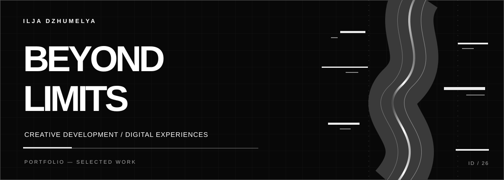
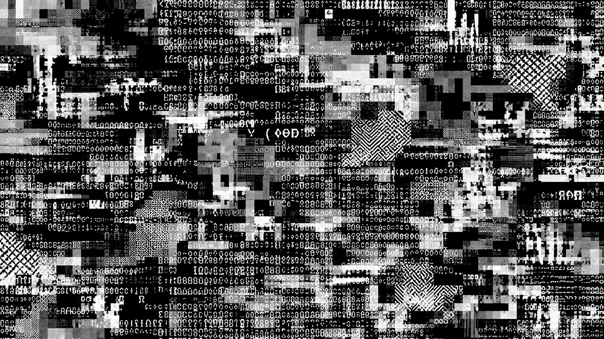
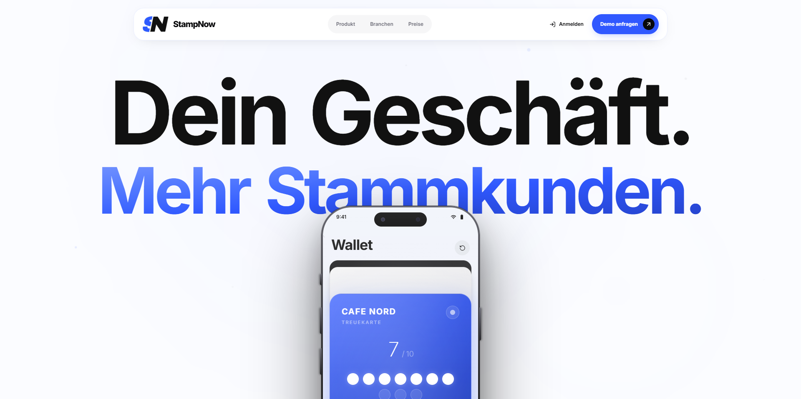
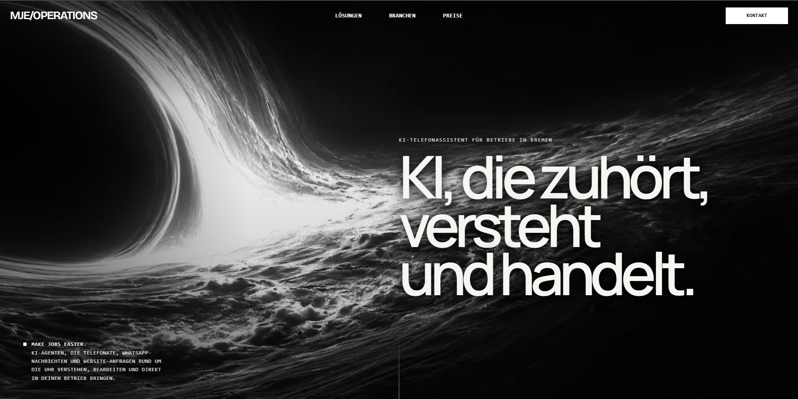
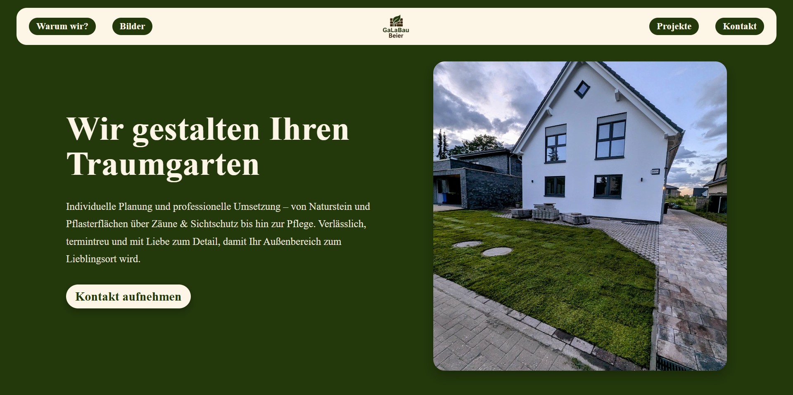
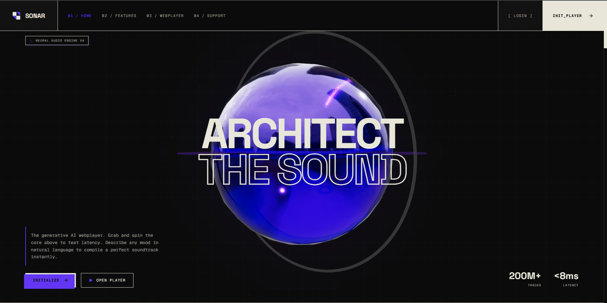
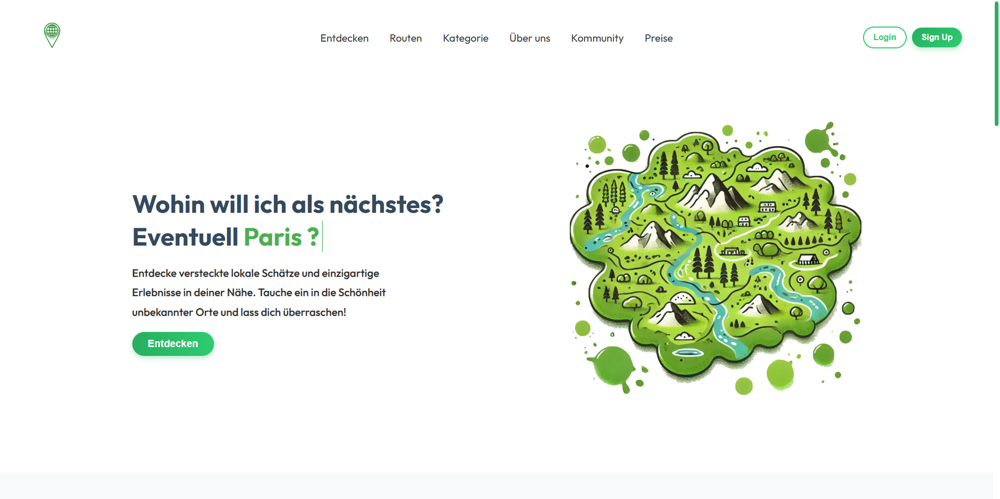

<p align="center">
  
</p>

<p align="center">
  <strong>Creative Developer · Digital Experiences · Beyond Limits</strong>
</p>

<p align="center">
  <a href="#the-experience">The Experience</a> &nbsp;·&nbsp;
  <a href="#selected-work">Selected Work</a> &nbsp;·&nbsp;
  <a href="#the-stack">The Stack</a> &nbsp;·&nbsp;
  <a href="#run-it-locally">Run It Locally</a>
</p>

---

## The Experience

This portfolio is built as a scroll driven journey. A monochrome hero opens into a digital rift, reveals **MY WORLD**, and leads into a stack of six projects. The final section returns to black and gives the next chapter its own space.

The site is still growing. Each section is designed and built piece by piece.

## Selected Work

<table>
  <tr>
    <td width="50%" valign="top">
      <a href="https://github.com/IljaDzhumelya24/infinity-portfolio"></a><br />
      <strong>01 / Portfolio</strong><br />
      The site you are looking at. <a href="https://github.com/IljaDzhumelya24/infinity-portfolio">Explore the code ↗</a>
    </td>
    <td width="50%" valign="top">
      <a href="https://stampnow.de/"></a><br />
      <strong>02 / StampNow</strong><br />
      Digital loyalty cards for businesses. <a href="https://stampnow.de/">Visit site ↗</a>
    </td>
  </tr>
  <tr>
    <td width="50%" valign="top">
      <a href="https://mje-operations.de/"></a><br />
      <strong>03 / MJE/OPERATIONS</strong><br />
      AI assisted business communication. <a href="https://mje-operations.de/">Visit site ↗</a>
    </td>
    <td width="50%" valign="top">
      <a href="https://galabau-beier.de/"></a><br />
      <strong>04 / GaLaBau Beier</strong><br />
      A digital home for landscape design. <a href="https://galabau-beier.de/">Visit site ↗</a>
    </td>
  </tr>
  <tr>
    <td width="50%" valign="top">
      <a href="https://sonar-kypx.vercel.app/"></a><br />
      <strong>05 / Sonar</strong><br />
      An experimental audio experience. <a href="https://sonar-kypx.vercel.app/">Visit site ↗</a>
    </td>
    <td width="50%" valign="top">
      <a href="https://github.com/IljaDzhumelya24/Hidden-Local-Gems"></a><br />
      <strong>06 / Hidden Local Gems</strong><br />
      Discover places beyond the obvious. <a href="https://github.com/IljaDzhumelya24/Hidden-Local-Gems">Explore the code ↗</a>
    </td>
  </tr>
</table>

## The Stack

**React · TypeScript · Vite · Tailwind CSS · GSAP / ScrollTrigger**

The project also includes **anime.js**, **Motion**, and **Kokonut UI** for future experiments and components.

## Run It Locally

```bash
npm install
npm run dev
```

Open the local URL printed by Vite. To create a production build:

```bash
npm run build
```

---

<p align="center"><strong>NO BOUNDARIES. JUST CREATIVITY.</strong></p>

